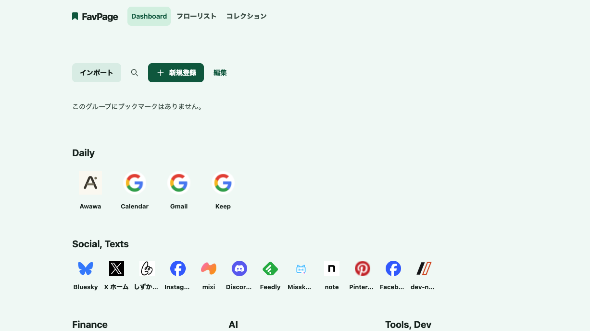

# favvvvvv



favvvvvv は、設置者自身の Cloudflare アカウントで運用するブックマーク管理アプリです。Vue.js の画面と Void のサーバー処理がひとつの Worker で動作し、設置先ごとの D1 にデータを保存します。同じ設置先を複数の Google アカウントで利用できます。名称は `fav` と `www` を組み合わせた造語です。

設置者は Google アカウントのメールアドレスを許可リストに登録します。認証には Better Auth を使い、Google が確認済みとしたメールアドレスを許可リストと照合します。ブックマークの一覧・検索・編集・削除は、ログイン中のアカウントのデータを対象とします。

## Dashboard とコレクション

**Dashboard** は、頻繁に使うブックマークの一覧です。グループで分類し、セクションで列を分けて配置できます。

**フローリスト** では URL を追加すると、新しいリンクから順に表示します。登録時にページのタイトルとサムネイルを取得し、取得できない情報にはホスト名と頭文字アイコンを使用します。取得した画像は設置先の D1 に保存し、favvvvvv から配信します。

**コレクション** では分類ごとにページを作成できます。フローリストのリンクは複数のコレクションに追加できます。コレクションから Dashboard に追加すると、タイトルと URL が Dashboard の「グループなし」に登録されます。同じ URL が Dashboard にある場合は既存のブックマークを使用します。

### Dashboard のセクションとグループ

Dashboard の「編集」から「セクションを追加」を選び、1〜3列の表示を設定します。各セクションの操作列でグループやブックマークを追加できます。グリップをドラッグするとセクションの順序を変更でき、右上の × から確認ダイアログを経てセクションとその中のグループ、ブックマークを削除できます。

Dashboard 上部の「グループを追加」から、Dashboard 直下にグループを作成できます。編集モードでグループのグリップをドラッグするか、グリップを選択して表示される「移動先」から、Dashboard 直下とセクションの間で移動できます。

各グループの鉛筆アイコンから、アイコン大・アイコン小・リスト大・リスト小を選択できます。リスト表示は1〜3列を指定でき、スマートフォン幅では1列になります。アイコン表示は利用可能な幅に応じて折り返します。

ブックマークの登録・編集画面で登録先を選択します。セクションやグループの＋アイコンを使うと、その位置があらかじめ選択されます。「グループなし」の項目は一覧の最後にリスト小で表示されます。HTML からインポートしたブックマークは「グループなし」に登録されます。

## ブラウザからのインポート

Chrome のブックマーク マネージャや Firefox のブックマーク管理画面から HTML 形式でエクスポートします。favvvvvv の一覧で「インポート」を選択し、最大 50 MB の HTML ファイルを指定します。 [Chrome のエクスポート手順](https://support.google.com/chrome/answer/96816) · [Firefox のエクスポート手順](https://support.mozilla.org/en-US/kb/export-firefox-bookmarks-to-backup-or-transfer)

フォルダー内の項目も現在の一覧に追加されます。対象は HTTP と HTTPS の URL です。同じアカウントの登録済み URL と、ファイル内の重複はスキップし、追加・重複・対象外の件数を表示します。途中で中断した場合は、同じファイルで再試行できます。追加した各ブックマークは、登録として監査ログに記録されます。

## Android にインストール

デプロイした favvvvvv の HTTPS URL を Android の Chrome で開きます。その他メニュー（︙）から「インストールしてショートカットを作成」または「ホーム画面に追加」を選び、「インストール」を選択します。ホーム画面の favvvvvv アイコンから起動できます。 [Chrome のウェブアプリ導入手順](https://support.google.com/chrome/answer/9658361?co=GENIE.Platform%3DAndroid&hl=ja)

起動先は Dashboard です。セッションが有効でない場合は、Google ログイン画面に遷移します。ブックマークの閲覧と編集にはネット接続が必要です。

### Android からリンクを共有

Android の Chrome で favvvvvv をウェブアプリとしてインストールすると、Chrome などのアプリの共有先に favvvvvv が表示されます。共有メニューで favvvvvv を選択し、フローリストの入力欄に入った URL を確認して＋アイコンで追加します。ログインが必要な場合は、Google ログイン後に同じ入力欄へ戻ります。

共有先への登録には Chrome による WebAPK 形式のインストールが必要です。既にインストール済みの場合は Chrome がアプリの情報を更新してから表示されます。 [Web Share Target の対応環境](https://web.dev/learn/pwa/os-integration#web-share-target) · [Android でのアプリ情報の更新](https://web.dev/articles/manifest-updates#updates_on_chrome_for_android)

## ローカル開発

Node.js 24.22 以降の 24 系、または 26.12 以降を使用します。

```sh
git clone https://github.com/nekobato/favvvvvv.git
cd favvvvvv
npm ci
npm exec -- void db migrate
npm run dev -- --host localhost --port 5173 --strictPort
```

`http://localhost:5173` を開きます。ローカルで Google ログインを利用する場合は、Google Cloud でウェブアプリケーション用の OAuth クライアントを作成し、承認済みのリダイレクト URI に `http://localhost:5173/api/auth/callback/google` を登録します。クライアント情報と許可するメールアドレスを、プロジェクト直下の `.env` に設定します。 [Google の OAuth クライアント設定](https://developers.google.com/identity/openid-connect/openid-connect)

```dotenv
AUTH_GOOGLE_CLIENT_ID=your-client-id.apps.googleusercontent.com
AUTH_GOOGLE_CLIENT_SECRET=your-client-secret
FAVVVVVV_ALLOWED_EMAILS=owner@example.com,second-account@example.com
```

許可リストはカンマ区切りです。空欄の場合はすべてのアカウントのアクセスを拒否します。ローカル開発では変更後に開発サーバーを再起動します。

```sh
npm run typecheck
npm run build
```

## Cloudflare へのデプロイ

### Worker の構成

通常の利用には **favvvvvv 本体の Worker 1つ**が必要です。本体が画面、Google ログイン、D1 へのアクセスを担当します。

フローリストのタイトルとサムネイルの取得経路を favvvvvv の公開側から分離する場合は、**取得専用 Worker** を同じ Cloudflare アカウントに追加します。取得側は公開 URL を持たず、本体から Service Binding 経由で登録先 URL だけを受け取ります。D1 や Google ログインのシークレットを取得側に渡さずに済みます。 [Cloudflare の Service Bindings](https://developers.cloudflare.com/workers/runtime-apis/bindings/service-bindings/)

外部サイトへの取得リクエストには Cloudflare が `CF-Worker` を付けます。取得専用 Worker を経由した場合に、favvvvvv の公開ホスト名とゾーン名が受信側に現れないことを検証してから有効にします。 [Cloudflare の `CF-Worker` ヘッダー](https://developers.cloudflare.com/fundamentals/reference/http-headers/#cf-worker)

### 本体 Worker をデプロイする

[](https://deploy.workers.cloudflare.com/?url=https://github.com/nekobato/favvvvvv)

Cloudflare のセットアップで本体の Worker と専用の D1 データベースを作成します。ビルドコマンドに `npm run build`、デプロイコマンドに `npx wrangler deploy` を使用します。 [Deploy to Cloudflare の仕様](https://developers.cloudflare.com/workers/platform/deploy-buttons/)

デプロイ後、Cloudflare が作成したリポジトリを clone し、そのディレクトリで D1 のマイグレーションを適用します。 [Cloudflare の D1 マイグレーション](https://developers.cloudflare.com/d1/wrangler-commands/#d1-migrations-apply)

```sh
npx wrangler login
npx wrangler d1 migrations apply DB --remote
```

### Void CLI で本体をデプロイする

Void CLI 用の作業コピーでは、Git の sparse checkout でボタン用の `wrangler.toml` を除外します。初回デプロイ時に Void が D1 を作成し、`db/migrations/` のマイグレーションを適用します。 [Void の Cloudflare デプロイ](https://void.cloud/integrations/cloudflare)

```sh
git sparse-checkout set --no-cone '/*' '!/wrangler.toml'
npm ci
npm exec -- void connect --platform cloudflare
npm exec -- void deploy --platform cloudflare
```

Void は設置先に対応する Cloudflare アカウントと D1 の識別子を `void.lock.json` に記録します。同じ設置先を更新する際に使うため、このファイルは設置先ごとに保管します。

### Google ログインを設定する

デプロイ結果の URL に `/api/auth/callback/google` を加えた URI を、設置先用の Google OAuth クライアントに登録します。`AUTH_GOOGLE_CLIENT_ID`、`AUTH_GOOGLE_CLIENT_SECRET`、`FAVVVVVV_ALLOWED_EMAILS` は、Cloudflare の本体 Worker の「Settings」→「Variables and Secrets」で設定できます。 [Cloudflare のシークレット設定](https://developers.cloudflare.com/workers/configuration/secrets/)

本体をボタンでデプロイした場合は、同じ画面のシークレットに `BETTER_AUTH_SECRET` も追加し、`openssl rand -hex 32` で生成した値を設定します。

Void CLI で管理している場合は、次のコマンドでも設定できます。入力内容はプロンプトで指定します。 [Void のシークレット設定](https://void.cloud/reference/cli/secrets)

```sh
npm exec -- void secret put AUTH_GOOGLE_CLIENT_ID
npm exec -- void secret put AUTH_GOOGLE_CLIENT_SECRET
npm exec -- void secret put FAVVVVVV_ALLOWED_EMAILS
```

利用を取り消す場合は、対象のメールアドレスを除いた許可リストで `FAVVVVVV_ALLOWED_EMAILS` を更新します。変更が反映された Worker は、対象アカウントの既存セッションからのブックマーク操作も拒否します。

### 取得専用 Worker を接続する

初期設定では本体の Worker が公開 URL のプレビューを取得します。分離する場合は、以下のボタンから `workers/metadata/` の Worker を本体と同じアカウントにデプロイします。 [Deploy to Cloudflare の仕様](https://developers.cloudflare.com/workers/platform/deploy-buttons/)

[](https://deploy.workers.cloudflare.com/?url=https://github.com/nekobato/favvvvvv/tree/main/workers/metadata)

本体をボタンでデプロイした場合は、Cloudflare が作成した本体リポジトリの `wrangler.toml` に次の設定を追加して再デプロイします。`service` には取得専用 Worker のデプロイ名を指定します。

```toml
[vars]
FAVVVVVV_METADATA_MODE = "binding"

[[services]]
binding = "METADATA_FETCHER"
service = "favvvvvv-metadata"
```

本体を Void CLI でデプロイした場合は、`void.config.ts` の `cloudflare` に Service Binding と環境変数を設定して再デプロイします。 [Void の Cloudflare バインディング設定](https://void.cloud/integrations/cloudflare)

```ts
cloudflare: {
  name: "favvvvvv",
  services: [{ binding: "METADATA_FETCHER", service: "favvvvvv-metadata" }],
  vars: { FAVVVVVV_METADATA_MODE: "binding" },
},
```

`binding` モードで取得専用 Worker を利用できない場合は、ホスト名と頭文字アイコンで保存します。プレビュー取得を停止する場合は `FAVVVVVV_METADATA_MODE` を `off` に設定します。

### 旧環境変数からの移行

既存の設置先では `FAVPAGE_ALLOWED_EMAILS` と `FAVPAGE_METADATA_MODE` も利用できます。同じ設定に新旧両方の変数がある場合は `FAVVVVVV_` で始まる変数が優先されます。

## 監査ログ

監査ログは標準で有効です。各設置先の D1 に、ログイン許可判定での拒否、セッションの開始・終了、ブックマーク・グループ・セクションの追加・更新・削除、フローリストの追加、コレクションの作成とリンクの追加・解除を記録します。セッションの終了には、ログアウトや期限切れセッションの削除が含まれます。

履歴に保存する項目は、UTC の日時、イベント種別、該当するアカウント・ブックマーク・グループ・セクション・コレクション・リンクの内部 ID、拒否理由です。既存の設置先では、マイグレーション適用後から新しいイベントを記録します。

設置者は D1 の権限で直近の履歴を確認できます。ローカル開発では `--remote` を省略します。 [Void のデータベースコマンド](https://void.cloud/reference/cli/database#void-db-execute)

```sh
npm exec -- void db execute --remote \
  'SELECT occurred_at, event, user_id, bookmark_id, group_id, collection_id, link_id, reason FROM audit_events ORDER BY id DESC LIMIT 100'
```
